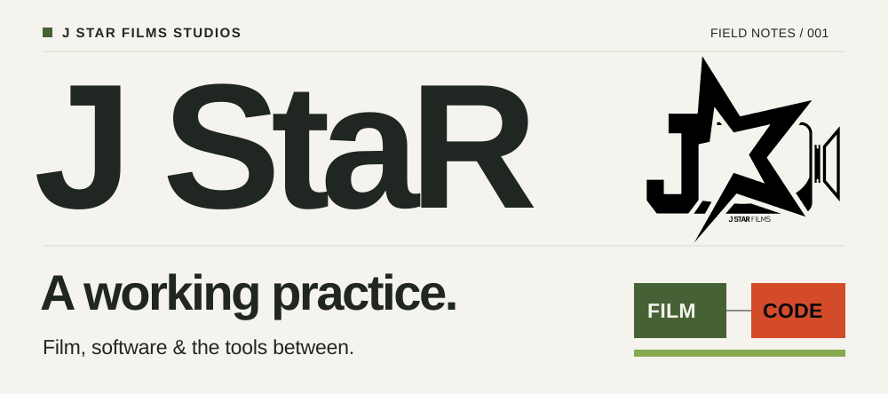
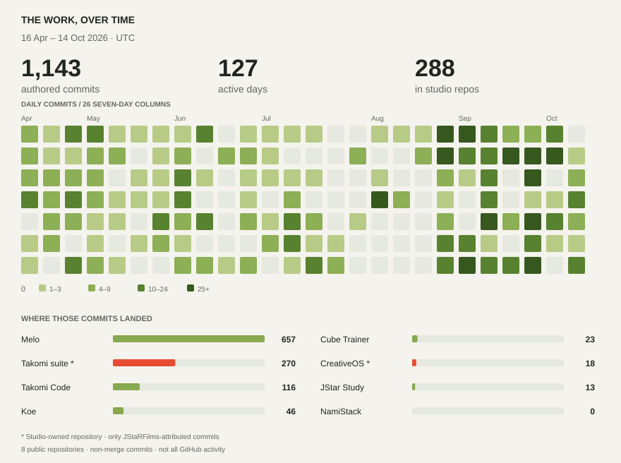

<picture>
  <source media="(prefers-color-scheme: dark) and (max-width: 600px)" srcset="assets/hero-dark-mobile.svg">
  <source media="(max-width: 600px)" srcset="assets/hero-light-mobile.svg">
  <source media="(prefers-color-scheme: dark)" srcset="assets/hero-dark.svg">
  
</picture>

# Goodness (John) Oluleke-Oke / J StaR

I'm John, the filmmaker who keeps opening a code editor.

I make films at [J StaR Films Studios](https://www.jstarstudios.com/). Here you'll find the other side of my work: coding agents, school software, and tools for learning or getting an idea down before it disappears.

[Films & studio](https://www.jstarstudios.com/) · [Studio repositories](https://github.com/J-StaR-Films-Studios) · [Get in touch](https://www.jstarstudios.com/#project-enquiry)

## 01 / How I build

### [Takomi / VibeCode Protocol Suite](https://github.com/J-StaR-Films-Studios/VibeCode-Protocol-Suite)

A new coding agent shouldn't mean explaining the whole process again.

This is the foundation of my workflow. Reusable skills, agent roles, and review steps that travel between coding tools, so I can change tools without rebuilding the process.

### [Takomi Code](https://github.com/JStaRFilms/Takomi-Code)

A workspace for coding agents, built on my fork of [T3 Code](https://github.com/pingdotgg/t3code). It adds Takomi/Pi integration, with desktop, browser, and Android access.

The suite holds the methods. Takomi Code runs the agents on the computer, even when I'm connecting from a phone.

[Get a release](https://github.com/JStaRFilms/Takomi-Code/releases)

## 02 / What I build

### [Melo](https://github.com/JStaRFilms/Melo_School_Management_System)

A school-management system for teacher planning, parent/student portals, admissions, and billing. Its AI can draft curriculum proposals from scheme-of-work documents. An administrator still gets the last word.

### [JStar Study](https://github.com/JStaRFilms/adaptive-study-game)

Close the notes. What can you actually remember?

Previously Adaptive Study Game. Turn notes, documents, and video into quizzes, visual reading canvases, and exam practice.

### [Koe](https://github.com/JStaRFilms/Koe)

For thoughts that arrive faster than I type.

Voice dictation with desktop hotkeys, text insertion, and a mobile app. Speech detection runs locally. Transcription goes to Groq's cloud API, so this isn't offline dictation.

### [CreativeOS](https://github.com/J-StaR-Films-Studios/CreativeOS)

The film is finished. Its files still need somewhere to go.

A Python CLI for setting up project folders, syncing notes with Obsidian, and archiving or moving projects between drives.

Also on the workbench

- [Cube Trainer](https://github.com/JStaRFilms/rubiks-cube-trainer): speedcubing practice with local history and offline preparation.
- [NamiStack](https://github.com/JStaRFilms/namistack): a Windows FFmpeg workbench for converting and merging media. See the command before you run it.

## 03 / The work, over time

I like seeing the work add up. Here's **182 complete UTC days across eight public projects**, including two in the studio account.

<picture>
  <source media="(prefers-color-scheme: dark) and (max-width: 600px)" srcset="assets/activity-dark-mobile.svg">
  <source media="(max-width: 600px)" srcset="assets/activity-light-mobile.svg">
  <source media="(prefers-color-scheme: dark)" srcset="assets/activity-dark.svg">
  
</picture>

My attributed, non-merge commits on those projects' default branches. This is a dated snapshot, not all my GitHub contributions.

[Counts, sources, and exclusions](ACTIVITY.md)

How the graph stays honest

GitHub must attribute each counted commit to `JStaRFilms`. Dates use the commit's committer timestamp in UTC. Private repositories and other people's commits aren't counted. Shared commit SHAs count once in the overall total.

The snapshot can be refreshed manually. The printed dates show exactly which period you're looking at. [Refresh instructions](MAINTENANCE.md).

---

Have a project in mind? [Let's talk.](https://www.jstarstudios.com/#project-enquiry)
